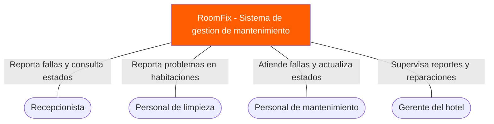
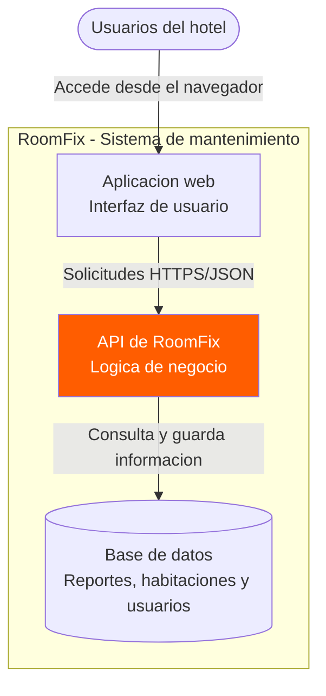
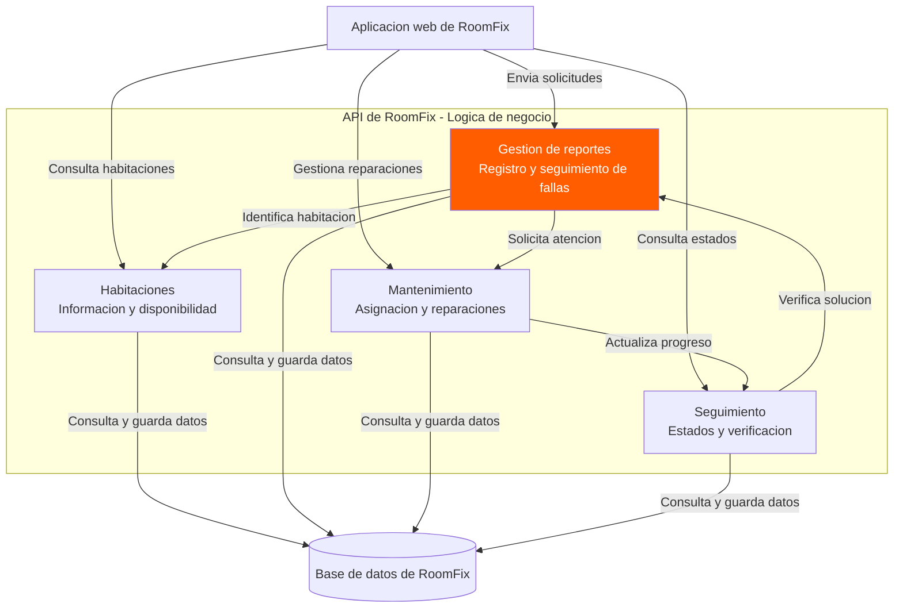

# Diagramas de arquitectura de RoomFix

## 1. Diagrama de contexto (C4 - Nivel 1)

## 2. Diagrama de contenedores (C4 - Nivel 2)

## 3. Diagrama de componentes (C4 - Nivel 3)

## 4. Tecnologías y límites de la propuesta

Los diagramas C4 describen una **aplicación web**, una **API de lógica de negocio** y una **base de datos**. La comunicación entre la aplicación web y la API se representa como **HTTPS/JSON**. **No se han seleccionado ni documentado todavía** el framework web, el lenguaje de la API ni el motor de base de datos; no deben presentarse como decisiones ya tomadas.

La arquitectura elegida es un **monolito modular**. Véase [ADR-001](./adr-001-monolito-modular.md).

## 5. Diseño propuesto y cambio solicitado

- [Patrón Observer propuesto](./patron-observer.md): posible reacción a cambios de estado, aún no implementada.
- [Análisis de impacto SC-001](./analisis-impacto-sc-001.md): fotografías antes y después de la reparación, estimación y decisión.

## 6. Concordancia entre diagramas UML

En el diagrama de secuencia de **CU-01 Registrar falla**, la aplicación invoca `Usuario.registrarFalla(numeroHabitacion, tipo, descripcion)` y este solicita `Falla.crearRegistro(numeroHabitacion, tipo, descripcion)`. Ambas operaciones figuran en el diagrama de clases. La segunda se hizo explícita para que el mensaje de creación del diagrama de secuencia tenga una operación correspondiente. Estos diagramas describen el **diseño**, no código implementado.
